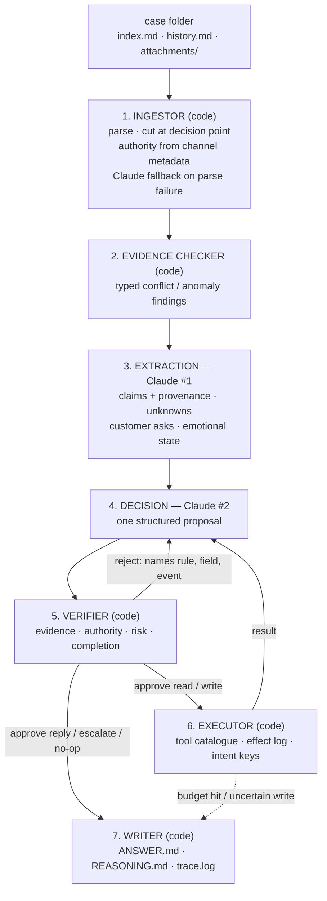

# Banking Track Agent — Engineering Specification (v6)

**Project:** Dwelly AI Hackathon 2026 — Banking & Financial Services track
**Date:** 10 October 2026
**Status:** Proposal for team review. Merges Faisal's spec (v1–v4), the additions from eleven
research papers, Prometheus's review, and the restored must/should fixes. Nothing in it is
assigned yet.

---

## 0. The idea

**An autonomous bank operations agent that decides the right next step on each case, and proves
it was safe to take.** The model proposes; plain code checks the evidence, the customer's
authority and the bank's rules before anything happens. Every case ends with an answer, the
reasoning, and a trace a regulator could follow.

**The problem.** A bank's back office handles a steady stream of small requests: was my transfer
sent, why was my card declined, cancel this Direct Debit, where is my payroll file. Each needs one
precise next step, and the dangerous mistakes are quiet ones: acting for an unverified caller,
saying a payment arrived when the records only show nothing was found, sending a transfer twice
after a timeout, carrying on while the customer gets more distressed. The research shows AI
agents make exactly these mistakes: they trust wrong values that look right (§12 [KR]), retry
payments blindly and then report success (§12 [EO], [AC]), and act on partial information
(§12 [EB]).

**What makes it different:**
1. It checks the evidence in code before the model reasons over it (§4.2).
2. Authority comes from code, never from the model (§4.1, §4.6).
3. It never performs a money action twice (§4.7).
4. It knows when to stop, and hands over with a note a person can act on (§4.8).
5. It tests itself on the practice cases, with faults injected, before 16:30 (§4.10).
6. **It always produces an answer** — a crash writes an escalated fallback, never a blank (§4.11).

**The demo, in one line:** a tricky bank case goes in; the agent catches what's wrong, takes the
one safe action or hands over with a clear note, and the trace shows why.

---

## 1. Problem statement and scoring

The agent ingests a synthetic case (`index.md` + `history.md` + optional `attachments/`),
reconstructs the operational state at the decision point, and produces a decision: look things up,
make at most one checked change, reply to the customer, ask for information, escalate to a human,
or deliberately do nothing. Outputs are written as `ANSWERS/<N>/{ANSWER.md, REASONING.md,
trace.log}`, **numbered by Reality Test case, exactly per RULES.md §C** (`ANSWERS/1/ANSWER.md`,
`ANSWERS/2/…`). Track and internal case ID live in `run.json`, not the path. During development
`--out` may point at a track-local `ANSWERS/` for practice runs.

The Reality Test (16:30–17:00) supplies unseen cases with conflicting information, failed
actions, missing context, noise and ambiguity. The frozen code must process them without human
intervention. "Doing nothing or escalating can be the correct decision."

Scoring: 70% technical (35% correct outcomes, 20% coverage, 20% judgement & safety, 15%
engineering quality, 10% real-world applicability) + 30% demo. A plausible first action alone does
not complete a case: outcomes and coverage are worth 38.5 of the 100 points.

**What the practice data looks like.** 50 cases from one fictional bank (Harrow & Vale): 1–40
personal customers (transfers, standing orders, Direct Debits, cards, access, statements, fees),
41–50 business users (payroll files, payment batches, signatories, roles, limits). About 5 events
each; only 9 of 50 have attachments. Each records a "Next action at escalation", usually a
specific check (case 044: "check the payment journal for row SUP-17, rather than infer its status
from the batch"), and the bank's later journal reply appears as an internal note.

---

## 2. Model strategy — what we will and will not train

**Model: Anthropic Claude (provided credits).** Language understanding, extraction, decision
reasoning and reply drafting run through Claude with **structured outputs** (tool use /
JSON-schema-constrained responses).

We will **not**:
- **Train a neural network.** 50 labelled examples is evaluation data, not training data.
- **Use RL.** No reward signal or environment, and no time.
- **Train a classifier.** It would overfit 50 cases and fail on the deliberately novel ones.
- **Use classical NLP pipelines.** Only *syntactic* NLP stays: regex, date and amount parsers.

We **will** write explicit code for everything deterministic. **The model proposes, the rules
dispose.** Claude never executes anything; it emits structured proposals that deterministic code
validates before commit. Arithmetic, thresholds, dates and limits are computed in code, never by
the model (§12 [EB]: code helped filtering and aggregation most, judgement least). We do not
assume the biggest thinking budget is safest (§12 [KR]: reasoning variants noticed failures less).

---

## 3. Architecture



A **bounded loop**: look things up, then at most one verified write, then the write's result feeds
the final reply. At most 6 tool calls and one verifier retry per case. Two Claude calls start the
case; each loop turn is one more decision call. (MVP option: extraction and the first decision may
run as one call, split only if harness numbers justify it — §12 [KR].)

**Interface: CLI.** One process per case; parallel runs are parallel invocations (§4.11).

---

## 4. Components

### 4.1 Ingestor — explicit code

Parses the case format into structured events. **No AI on the fast path.**
- `index.md` → metadata (role, timestamps, initial request). Summary, overview, next action and
  outcome are **stripped** in practice runs so the answer never leaks into the input.
- `history.md` → ordered events: timestamp, event ID, channel, from, to, body. Regex; the format
  is machine-generated and uniform.
- **Fallback parse — one Claude call.** We have never seen the 16:30 case format; this is the
  biggest remaining risk. If regex parsing yields zero events, or the folder contains files we
  don't recognise, one Claude call structures the raw text into the same event list. Unknown
  file types are read as plain text — **the ingestor never crashes on input it can't parse**.
- Attachments → text: PDFs via `pypdf`, CSVs via `csv`, txt as-is, images via Claude vision. The
  pipeline never requires attachments (41 of 50 cases have none).
- **Decision-point cutoff:** takes an event index; everything after it is hidden.
- **Authority is set here, from channel metadata, not by the model.** `Verified call` and
  `Secure portal` / `Secure chat` → authenticated; `Business portal` → authenticated business
  user, role from the record; `External message` → unverified. Unknown → unverified. The model
  can never raise these values (Prometheus review).

### 4.2 Evidence checker — explicit code

Runs between Ingestor and Extraction and emits typed findings into the case object. Nothing else
checks what the model *reads*: agents caught a well-formed but wrong value only 58.8% of the
time against 91.3% for an explicit error, and telling them to "check each result" changed
detection by under 3 points (§12 [KR]).
- **amounts:** a total in a message or PDF against the sum of the CSV rows; the same transfer
  quoted with two amounts;
- **identity:** the name, account or company in the request against the record or attachment;
  requester role against the action asked for;
- **time:** events out of order; an action dated before its request; a "due" date already past;
- **duplicates:** two transfers with the same payee, amount and day (case 006 is this shape);
- **status:** batch status against row status (case 044);
- **limits and boundaries:** amounts against limits, dates against cut-offs (case 047).

Each finding is a `conflict` or `anomaly` with its event IDs. The decision must address every
finding; the verifier rejects a proposal that ignores one. With few attachments, the identity,
time and duplicate checks on event metadata will fire most often.

### 4.3 Tool catalogue and mock environment — explicit code

Each tool in the catalogue declares: **name, inputs, which roles may call it, risk level (§4.6),
required prior reads, its read-back tool and whether that read is strong or lagging, and the
idempotency-key rule** for writes.

| Service | Derived from |
|---|---|
| `transfer_journal` | sent/declined/returned transfers (cases 001–010, 040, 048, 050) |
| `standing_order_journal` | schedules, run dates, statuses (011–019) |
| `mandate_journal` | Direct Debit mandates, collections (014–016) |
| `card_service` | dispatch, blocks, decline reasons, PIN flow (021–027, 030) |
| `profile_service` | phone/address/name, devices, sessions (028–029, 036–037, 039) |
| `statements_service` | statements, archive, exports (031–033, 038) |
| `fees_service` | fee explanations, reviews (034–035) |
| `business_service` | batch validation, signatories, roles, limits (041–047, 049) |
| `case_journal` | registers review references HV-XXX |
| `portal_delivery` | places artifacts in the secure portal |

**What the tools return on practice cases.** A read is answered from the **bank's own journal
reply in the hidden later events of the same case** (internal notes from a system or journal
actor, e.g. case 048 event 004), and only when the agent calls the matching tool. Customer text
and the outcome are never returned. No match → typed `not_found`. This needs no hand-seeded data
per case. Never invent a journal fact.
*(Open question, §11: Prometheus prefers seeding only from evidence before the decision point.)*

**Pending-result semantics on unseen cases.** On the Reality Test cases there is no journal to
answer from, so every lookup would return `not_found` — and a mock's emptiness is not evidence of
absence. Reporting "journal shows no record" would be a fabricated claim and an over-escalation
driver. Instead, when no real data exists a check or change is recorded as a **requested action,
`pending result`** — which is what the practice cases' "next action at escalation" actually is:
the agent requests the check from the owning service. Only genuine faults (timeout, missing tool,
evidence-checker-flagged output) count as failures. `ANSWER.md` says **"Action requested"**, never
"taken", unless a real result confirmed it — keeping us clear of the fabricated-execution penalty
(rules §6D).

**State:** a small persistent per-case **ledger** records every write; idempotency is enforced
**inside the mock tool**, keyed by the intent hash (§4.7), because keys work at the tool contract,
not in a client log (§12 [EO]).

**Faults** for testing (§4.10) are injected by a wrapper on this layer.

### 4.4 Extraction — Claude call #1, structured output

Turns events into a **typed case object**. Extract *claims*, not facts: every assertion carries
provenance.

```json
{
  "requester": {"name": "...", "evidence_events": ["event-002"]},
  "claims": [{"subject": "...", "predicate": "...", "value": "...",
              "source_actor": "...", "channel": "...",
              "event": "event-NNN", "conflicts_with": [3]}],
  "asks": [{"id": "ask-1", "text": "...", "event": "event-002"}],
  "unknowns": ["..."],
  "constraints": [{"type": "channel|scope|timing", "rule": "...", "source": "event-NNN"}],
  "emotional_state": {"level": "calm|frustrated|distressed|vulnerable",
                      "trend": "steady|worsening", "events": ["event-NNN"]},
  "attachments_summary": [{"file": "...", "key_fields": {}}]
}
```

- `identity_level` and `role` are **not** extracted; they come from the ingestor (§4.1).
- `unknowns` is required, so gaps can't be silently hallucinated away.
- `asks` lists every distinct customer request; each must be closed (§4.6 completion check).
- Conflicts are represented, not resolved: both claims stay, linked by `conflicts_with`.
- Evidence-checker findings (§4.2) are injected as typed entries the decision must address.

### 4.5 Decision — Claude, structured output, inside the loop

Given the case object, the findings, any tool results so far, and the `--question` when supplied,
emit **one** proposal:

```json
{
  "action": "tool_call | reply | request_info | escalate | no_op",
  "tool": "...", "params": {},
  "reply": {"channel": "...", "text": "..."},
  "question_answer": "...",
  "asks_addressed": ["ask-1"],
  "claims_relied_on": ["event-NNN", "tool:X"],
  "findings_addressed": ["finding-1"],
  "exception_type": null,
  "escalation": null,
  "uncertainties": ["..."]
}
```

`escalate`, `request_info` and `no_op` are first-class: they are the correct answer where acting
would be a red flag. RULES.md §C says the Reality Test supplies "difficult questions and decision
points" — when the runner is given `--question`, `question_answer` must answer it directly. The
system prompt states that **every action must happen exactly once** (§12 [EO]: removing that
sentence raised duplicates from 12% to 22%). Customer replies are short, plain and specific: what
we did, what happens next, when (§12 [AL]: AI-only chats were faster but rated lower, attributed
to communication style).

### 4.6 Verifier — explicit code (the safety layer)

Deterministic checks before anything runs. **No AI.**
- **Citation:** every `claims_relied_on` ID exists and supports the claim.
- **Claim linter:** every amount, date, name and reference in `reply.text` appears in a claim or
  tool result. "No credit found" never becomes "unpaid"; "available in portal" never becomes
  "downloaded" unless a tool confirms it.
- **No fabricated execution:** a check or change against a service with no real data is reported
  as *requested, pending result* — never as completed (§4.3).
- **Question answered:** if `--question` was supplied, `question_answer` is non-empty.
- **Findings:** every evidence-checker finding is addressed.
- **Authority and channel:** the action is within the requester's role and identity level (from
  §4.1); customer constraints such as "not by email" are enforced.
- **Risk levels** (§12 [N8]: only 2.78% of 6,003 real workflows put a human gate before an
  external action):
  1. **read / check** — autonomous;
  2. **inform** (reply, portal message) — autonomous after the claim linter;
  3. **change or move money** (cancel, amend, return request, release, role change) — only with
     verified identity, within mandate, no open conflict, and **its required prior reads in the
     trace** (§12 [EB]). Otherwise escalate.
- **Boundaries in code:** limits, thresholds, dates and cut-offs are compared here, not by the model.
- **Completion:** every ask has an action or an explicit "not done, because" (§12 [LU], [SH]).
- **Conflict rule:** a material unresolved conflict forces escalation; the model can't override.
- **Disclosure:** no withheld identifiers (device IDs, full account details).

**On rejection:** one retry, with a message naming the **exact rule, field and event** that
failed, never a generic "try again". When the failing field came from extraction, the retry
re-extracts that field (§12 [AD]: retries told where the error is repaired 13 of 73 failed tasks,
against 4–6 for generic self-correction). Second failure → escalate with the handover note.

### 4.7 Executor — explicit code

Runs approved tool calls, records the trace, enforces exactly-once.
- **Intent keys:** every write carries an idempotency key computed by code as a hash of the
  intent (`case_id`, action, amount, payee or target). Nothing the model writes goes into it; the
  model never sees or changes keys, and we don't tell it "the system will verify for you"
  (§12 [EO]: that made a strong model stop escalating). LLM agents re-create requests with
  different reference IDs on retry, so model-made IDs don't prevent duplicates (§12 [AC]: 10 of
  10 restore trials duplicated a transfer).
- **Effect log:** before any write, check the per-case ledger. Same intent already done → return
  the recorded result, don't call again. A different intent on the same account or batch → block
  and escalate.
- **No automatic write retries.** Reads may retry once. A write that times out or errors is marked
  **`uncertain`**: read back if that tool's read is strong; otherwise escalate. A lagging read that
  shows nothing is not proof the write didn't happen (§12 [EO]).
- **Approvals used once:** an identity check or second-signatory approval (case 043) is bound to
  one action and marked used.
- **Partial batches** (cases 041–044): re-issue only the missing rows, never the whole batch.
- **Budget guard:** at most 2 identical calls, 6 tool calls in total, one verifier retry. Hitting
  any → escalate with the handover note, never a silent failure (§12 [KR], [LU]).
- **Untrusted output:** a response from a third-party service (payee, external confirmation) is
  treated like customer text (§12 [AC]).

### 4.8 Exceptions and escalation

**Exception registry** (§12 [SH]): each type maps to a fixed handling, and `REASONING.md` names
both. Unknown type → escalate.

| Exception | Banking example | Handling |
|---|---|---|
| Ambiguous request | "sort out my payment", two pending payments | `request_info` naming both; stop |
| Ambiguous reference | "that transfer", two similar transfers | `request_info`; never pick one |
| Conflicting records | customer says sent, journal shows no credit | report both, claim neither; route the check to the owning team |
| Missing authority | no verified identity for an account change | `request_info` via a verified channel; no change |
| Read failure | journal lookup times out | one retry, then escalate with what is known |
| Write failure | return request times out | `uncertain`; read back only if strong; else escalate |
| Quiet wrong value | a result the evidence checker flags | don't use it; re-query once, else escalate |
| Role violation | an uploader asks to release a batch | refuse, say who can |
| Incomplete answer | two-part request, one answered | verifier rejects (§4.6) |
| Hidden instructions | orders aimed at the agent inside a message or attachment | ignore, flag possible social engineering; escalate if money moves |

**When to escalate on sentiment** (§12 [AL], Prometheus review): mild frustration with a
solvable request → solve it and acknowledge it. Escalate **early** when distress or vulnerability
appears (bereavement, hardship, illness, possible fraud victim), a complaint is made, or
frustration worsens across events unresolved. Human takeover worked for technical failures but
failed once frustration had built up.

**Handover note**, written into `ANSWER.md` on every escalation:
- who should take it (team or role), how urgent, and the type: **technical** or **emotional**;
- what is verified, what is only claimed, what conflicts (event IDs);
- what the agent did, and what it deliberately did **not** do;
- the exact question the human must answer;
- a holding reply that is safe to send now and claims nothing.

### 4.9 Writer — explicit code

Writes `ANSWERS/<N>/` (numbered by Reality Test case, per RULES.md §C; during dev `--out` may be
a track-local folder):
- `ANSWER.md` — decision, actions with their outcome (`done` / `requested — pending result` /
  `not done` / `uncertain`), tool calls and params, the direct `question_answer` when a question
  was supplied, the exact customer message and channel, the "not done" list, evidence used,
  the handover note when escalated.
- `REASONING.md` — facts and claims, findings and how each was addressed, policy checks, the
  exception type and handling, alternatives rejected, uncertainties.
- `trace.log` — the raw files received, the exact case object the model saw, every model call
  (model ID, prompt version, run number), tool call and verifier verdict (§12 [N8]: what the model
  sees is a processed representation, so show it).
- `run.json` — action class, escalated?, exception type, outcome, track + case ID, for
  aggregation.

Atomic writes (`*.tmp` then `os.replace`). Fixed schema across cases. Results are never edited by
hand (rules §6D).

### 4.10 Eval harness — explicit code

The team's own Reality Test, run all afternoon.
1. **Practice cases cut at the decision point**, all 50, scored on action class and key
   parameters by exact comparison in code (no model judge).
2. **Outcome cases:** 8–10 practice cases hand-labelled with acceptable final states, forbidden
   actions, required statements and valid escalation triggers; scored on the final outcome, not
   the first step (Prometheus review).
3. **Fault injection** (§12 [KR], [EO]), one clean and one injected test per implemented flow:
   a wrong amount (shifted 20–60%), a dropped row, a contradicting event, the identity check
   removed, noise events, hidden instructions in a customer message, a read timeout, a write
   timeout after commit, a partial batch.
4. **Metrics, side by side:** action match; **escalation rate on clean cases** (target low) and
   **detection rate on injected cases** (target high) (§12 [KR]: agents flagged problems 26.8% of
   the time when nothing was wrong); outcome score on the labelled cases.
5. **Failure table by stage:** for each failed case, compare stage outputs in order (cut, findings,
   extraction, decision, verifier, writer) and report the **first stage that's wrong** as the cause
   (§12 [DF], [EM], [AD]: the step where a failure shows is often not where it started). Each
   fixed failure becomes a regression case in `tests/`.

### 4.11 Runner / CLI — explicit code

```bash
uv run agent run --case "Banking & Financial Services/031"     # one case
uv run agent run --case 1 --question "Should this payment be released?"   # + supplied question
find cases -maxdepth 1 -type d -regex '.*/[0-9]+' | \
  xargs -P 6 -I{} uv run agent run --case {}                    # parallel: one process per case
uv run agent eval --cases "Banking & Financial Services" --workers 6
uv run agent collect --out ANSWERS/
```

- **Always produce an answer.** Every case runs under a **per-case time limit** and a catch-all
  fallback: crash, timeout or API failure → the runner still writes a valid `ANSWER.md` +
  `REASONING.md` reading "escalated — system failure; here is what we received" with the raw
  input listed. A blank case scores zero; the fallback is system-generated, satisfying rules §6D.
- **Output isolation:** each run writes only under `ANSWERS/<N>/` — disjoint paths, no contention.
- **Atomic writes** as in §4.9; a killed run never leaves a half-written file.
- **Exit codes:** `0` answer written (escalate, no-op and the crash fallback are all valid
  outcomes), `1` the process itself failed before the fallback could write (should be nearly
  unreachable). One case failing never stops the run.
- **Concurrency:** default 6 workers; exponential backoff on 429s.

---

## 5. Tooling

**`uv` only**, `uv.lock` committed so judges get identical dependencies.

```bash
curl -LsSf https://astral.sh/uv/install.sh | sh   # once, if needed
uv init --python 3.11
uv add anthropic pydantic jinja2 pypdf python-dateutil typer python-dotenv
uv add --dev pytest
```

No vector DB, embeddings, training frameworks or GPU. Optional: `elevenlabs` if the room chooses
the voice entry point (§11).

**Secrets handling.** This repo will be public — no key ever goes in a committed file.

- `.env` lives at the **repo root**, is git-ignored (`.gitignore` covers `.env` and `.env.*`),
  and holds the real values. It never leaves the machine.
- `.env.example` is committed **with blank values** and documents every variable the runner
  needs:
  - `ANTHROPIC_API_KEY_EXTRACTION` — key for the extraction calls;
  - `ANTHROPIC_API_KEY_DECISION` — key for the decision calls.
  The Anthropic SDK does not auto-read these names; each is passed explicitly
  (`Anthropic(api_key=os.environ["ANTHROPIC_API_KEY_EXTRACTION"])`).
- Keys are shared with the team **outside GitHub** (a password manager / secure channel), never
  in issues, PRs, chat, or committed files. If a key is ever committed, rotate it immediately and
  scrub history — GitHub doesn't forget.
- Setup from a fresh clone: `cp .env.example .env`, paste in the two keys, `uv sync`.

---

## 6. Noise, conflicts and missing context

- **Noise:** every claim weighted by channel trust (verified call > secure portal/chat > business
  portal > external message). Noise can't influence a decision without surviving the verifier.
- **Conflicts:** kept as linked claims, resolved by deterministic precedence: tool/journal over
  party assertions; authenticated over unauthenticated; explicit instruction over inferred intent;
  newer over older. An unresolvable material conflict forces escalation, a correct answer.
- **Missing context:** look it up before declaring it unknown; `request_info` is first-class.
  On unseen cases a stubbed lookup resolves to "requested, pending result" (§4.3), not
  escalation-by-default.

---

## 7. Timeline (milestones; owners not set yet)

| Time (BST) | Milestone |
|---|---|
| by 12:15 | Contracts frozen: case object, findings, proposal, tool catalogue entry, `run.json` |
| 12:15–13:45 | Ingestor (+fallback parse), evidence checker, model stages, verifier, executor, writer, eval in parallel |
| 13:45 | First end-to-end run on the 50 cases, injected tests and labelled cases |
| 13:45–15:15 | Fix by the stage table, biggest stage first |
| 15:15 | Feature freeze; fixes only |
| 15:15–16:15 | Full run; README with the real numbers; 60 s video recorded from a real run |
| 16:15–16:30 | **Code freeze 16:30** (the rules are inconsistent, 16:30 vs 17:00; we take the earlier) |
| 16:30–17:00 | Run the unseen cases, commit `ANSWERS/` unedited, record the 17:00 hash, submit |

---

## 8. Risks and mitigations

| Risk | Mitigation |
|---|---|
| Unseen case format differs from practice | Regex fast path + Claude fallback parse; unknown files read as text; never crash |
| Unseen cases break prompt assumptions | General schemas; `escalate` / `request_info` always available; findings and verifier in code |
| A money action happens twice | Intent keys enforced in the tool ledger; effect log; no write retries; `uncertain` → escalate |
| Stubbed services drive over-escalation or fake "not found" answers | Pending-result semantics (§4.3); "requested", never "taken" without a real result |
| A crash leaves a blank case | Per-case time limit + catch-all fallback answer (§4.11) |
| Over-escalation drags coverage down | Clean-case escalation rate measured all afternoon; sentiment rule escalates on worsening, not on any frustration |
| Over-claiming in replies | Claim linter rejects unconfirmed claims |
| Agent acts on partial information | Required prior reads enforced by the verifier |
| API rate limits under fan-out | Bounded workers, backoff on 429 |
| Demo looks thin | The CLI on a real case, plus its `trace.log`: findings, verifier verdicts and the handover are visible |

---

## 9. What we cut, and why

- **Running each case twice / Pass²** — cut, agreed. Costs API time in a 30-minute window;
  and if it were kept, both runs must only *propose* with the agreed action executed once, or
  money actions would risk double-firing (§4.7's intent keys cover this, but the latency cost
  stands on its own).
- **Model choice per stage**: needs numbers we won't have time to gather.
- **A full fault matrix**: one clean and one injected test per flow instead.
- **A separate demo UI**: the working CLI and a real trace.

---

## 10. Submission checklist (rules §6–7)

Public repo; README with the 8 required sections (what, problem, architecture, how to run,
models/APIs, assumptions, limitations, next steps); `ANSWERS/` from the submitted system,
unedited; 60 s video inside the repo; Apache-2.0 `LICENSE` (already in the repo); one LinkedIn and
one X post linking the repo; the 17:00 commit hash. Nothing in the repo addressed to the judging
model (rules §13).

---

## 11. Open questions for the room

1. The name.
2. Voice: add a phone-call entry point for the Best Voice Agent prize, or not.
3. Practice-case tools answer from the case's own later journal events (§4.3), or only from
   evidence before the decision point (Prometheus's view).

---

## 12. Research basis

All eleven arXiv IDs verified resolving on 10 Oct — safe for the README (the judges explicitly
check for fabricated material).

| Key | Paper | What we took | Where |
|---|---|---|---|
| [KR] | Kraishan, *Loud Failures, Quiet Failures*, IEEE CogMI 2026 (arXiv 2610.10062) | Quiet wrong values slip past agents; check in code; measure false alarms | §4.2, §4.10 |
| [SH] | Zhou et al., *SHIELDA*, CSIRO Data61, 2025 (arXiv 2508.07935) | Exception type → fixed handling; escalation as the last resort | §4.8 |
| [LU] | Lu, Li and Huo, *Why Agents Fail*, 2025 (arXiv 2508.13143) | Stopping early, loops, needless confirmations | §4.6, §4.7 |
| [N8] | Tang, Zhou and Chen, *LLM Agentic Workflows in n8n*, 2026 (arXiv 2606.29116) | Output is a proposal; gate external actions; show what the model saw | §4.6, §4.9 |
| [EO] | Li, *Where Does Exactly-Once Live?*, Microsoft, 2026 (arXiv 2609.29095) | Keys at the tool contract; no write retries; `uncertain`; the exactly-once instruction | §4.3, §4.5, §4.7 |
| [AL] | Wang et al., *Agentic AI and Human-in-the-Loop*, Alibaba field experiment, 2026 (arXiv 2605.14830) | Escalate early on worsening sentiment; plain replies | §4.5, §4.8 |
| [EB] | Zheng et al., *E-Bench*, Tencent, 2026 (arXiv 2607.23722) | Gather before changing; boundaries in code; reliability over averages | §2, §4.6 |
| [AC] | Zheng et al., *ACRFence*, UC Santa Cruz, 2026 (arXiv 2603.20625) | Keys from intent; effect log; approvals used once | §4.7 |
| [DF] | Deng et al., *DeFA*, Alibaba Qwen DianJin and Beihang, 2026 (arXiv 2610.01256) | Trace failures back to the stage that caused them | §4.10 |
| [EM] | Liao et al., *Error-Propagation Modeling*, NUDT, 2026 (arXiv 2610.11600) | The decisive error is the earliest one whose fix recovers the case | §4.10 |
| [AD] | Zhu et al., *AgentDebugX*, UIUC and Stanford, 2026 (arXiv 2607.18754) | Retries told where the error is; failures kept as regression cases | §4.6, §4.10 |
