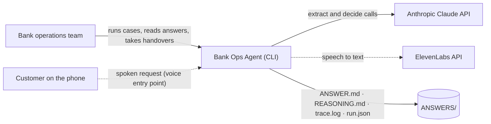
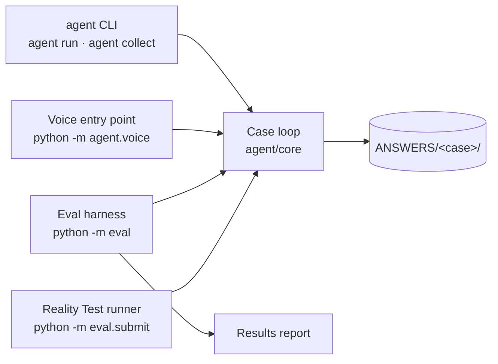
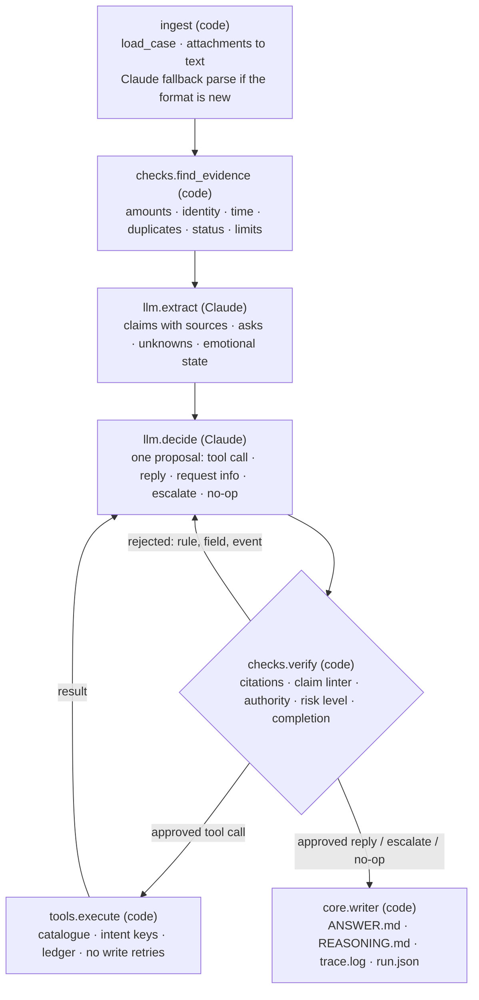

# Scale: bank operations agent

Team Scale's entry for the Real-World Agents Hackathon hosted by Dwelly in London on Saturday 10 October
2026, **Banking & Financial Services** track.

The rules we build and submit to: [docs/rules/RULES.md](docs/rules/RULES.md). How the team works
together: [TEAMWORK.md](TEAMWORK.md). The full engineering design: [AGENT_SPEC.md](AGENT_SPEC.md).

> **Technical design:** [AGENT_SPEC.md](AGENT_SPEC.md), the full engineering specification as built:
> every component, the safety rules, exception handling, idempotency, the research basis, and
> §13 *As built* with every change made during the build and the eval results by round.

## What we built

**An autonomous bank operations agent that decides the right next step on each case, and proves
it was safe to take.**

It reads a customer case the way a bank's back office receives it (the request, the message
history, any PDF, CSV or text attachments) and ends every case in exactly one of six outcomes:
it **does** a safe check, **requests** a check from the team that owns it, **asks** the customer
for what it can't safely guess, **escalates** to a person with a handover note, deliberately does
**nothing**, or, if something breaks, still writes a **system-failure** answer with everything it
received. No case is ever left blank.

The model proposes; plain code checks the evidence, the customer's authority and the bank's rules
before anything happens. Every case ends with an `ANSWER.md`, a `REASONING.md` and a `trace.log`
a regulator could follow.

## The operational problem it solves

A bank's back office handles a steady stream of small requests: was my transfer sent, why was my
card declined, cancel this Direct Debit, did row SUP-17 of our supplier batch get paid. Each one
needs one precise next step, and the dangerous mistakes are quiet ones:

- acting for an unverified sender, such as resending a payment to "new bank details";
- saying a payment arrived when the records only show it was sent;
- sending a transfer twice after a timeout;
- carrying on while the customer becomes more distressed.

Today's AI agents make exactly these mistakes: they trust wrong values that look right, retry
payments blindly, and report success when they shouldn't. Our agent is built so that those
mistakes are blocked by code, not by hoping the model behaves.

## Architecture

Full component-level detail: [AGENT_SPEC.md §3–§4](AGENT_SPEC.md#3-architecture); what changed during
the build: [§13](AGENT_SPEC.md#13-as-built-what-changed-during-the-build-10-oct).

### Level 1: context



### Level 2: containers



### Level 3: components of one case



How a case flows: the loop in [agent/core/loop.py](agent/core/loop.py) runs ingest, the evidence
checks and one extraction, then asks for one decision at a time. Each proposal goes through the
verifier before anything runs. A rejection goes back to the model with the exact rule, field and
event; a second rejection in the same turn escalates. At most 6 tool calls and 2 identical calls per
case, 240 seconds per case; hitting any limit escalates with a handover note. Any crash writes the
system-failure answer instead of a blank.

| Area | Code | What it does |
|---|---|---|
| ingest | [agent/ingest/](agent/ingest/) | Parses `index.md` and `history.md` into events, turns attachments into text, cuts practice cases at the decision point, sets identity from the channel (never from the model), and falls back to one Claude call when the format is unfamiliar |
| checks | [agent/checks/](agent/checks/) | `find_evidence`: six deterministic checks run before the model reads anything. `verify`: the safety gate every proposal passes |
| brain | [agent/llm/](agent/llm/) | Extraction and decision prompts with structured output, the exception registry, sentiment rules, the handover note, the customer-reply copy |
| tools | [agent/tools/](agent/tools/) | Tool catalogue with roles and risk levels, mock bank services, per-case ledger with intent keys, executor, fault wrapper for testing |
| core | [agent/core/](agent/core/) | Contracts, the Claude client, the bounded loop, the writer, the CLI |
| voice | [agent/voice/](agent/voice/) | Turns a spoken request into a case and runs it through the same loop |
| eval | [eval/](eval/) | Our own Reality Test: practice cases cut at the decision point, injected faults, judgement cases, a results report |

### How it reasons, and where to see it

The agent's thinking is written down for every case, in three places:

- **`REASONING.md`**: the facts and claims it relied on (each with its event ID), every evidence
  finding and how it was addressed, the policy checks, the exception type and its fixed handling,
  the alternatives it rejected and why, and what it is still unsure of.
- **`trace.log`**: the raw files received, the exact case object the model saw after the evidence
  checks, every model call (model, prompt, output), every proposal, every verifier verdict and
  every tool result, in order.
- **`ANSWER.md`**: the decision, the actions with their outcome (done, requested and pending,
  not done, uncertain), the reply to the customer, what it deliberately did not do and why, and the
  handover note when a person must take over.

The rule underneath all three: *the model suggests, code checks.* Identity comes from the channel;
amounts, dates and limits are compared in code; a money action needs verified or authenticated identity, the right
mandate, no open conflict and its prior checks in the trace; and no reply may claim "paid",
"received" or "refunded" unless a tool confirmed it.

### Research basis

Each safety rule comes from a published finding. Full mapping: [AGENT_SPEC.md §12](AGENT_SPEC.md).

| Paper | What we took |
|---|---|
| Kraishan, [*Loud Failures, Quiet Failures*](https://arxiv.org/abs/2610.10062) | Agents miss wrong values that look right, so evidence is checked in code; false alarms are measured too |
| Zhou et al., [*SHIELDA*](https://arxiv.org/abs/2508.07935) | Each exception type maps to one fixed handling |
| Lu, Li and Huo, [*Why agents fail*](https://arxiv.org/abs/2508.13143) | Guards against stopping early, loops and needless confirmations |
| Tang, Zhou and Chen, [*Agentic workflows in n8n*](https://arxiv.org/abs/2606.29116) | Model output is a proposal; external actions are gated; the trace shows what the model saw |
| Li, [*Where Does Exactly-Once Live?*](https://arxiv.org/abs/2609.29095) | Idempotency keys at the tool contract, no write retries, "uncertain" escalates |
| Wang et al., [*Agentic AI and human-in-the-loop*](https://arxiv.org/abs/2605.14830) | Escalate early when distress grows; short, plain replies |
| Zheng et al., [*E-Bench*](https://arxiv.org/abs/2607.23722) | Gather before changing; limits and thresholds compared in code |
| Zheng et al., [*ACRFence*](https://arxiv.org/abs/2603.20625) | Keys built from the intent, an effect log, approvals used once |
| Deng et al., [*DeFA*](https://arxiv.org/abs/2610.01256) | Failures traced back to the stage that caused them |
| Liao et al., [*Error-propagation modeling*](https://arxiv.org/abs/2610.11600) | The decisive error is the earliest one whose fix recovers the case |
| Zhu et al., [*AgentDebugX*](https://arxiv.org/abs/2607.18754) | Retries told exactly where the error is; fixed failures kept as regression tests |

### A real run

Practice case 044, cut at the decision point: the portal says the supplier batch is *Processed*,
and the customer asks whether row SUP-17 was paid. Output of
`uv run agent run --case examples/044 --cut 2 --out /tmp/demo/044`, unedited apart from the output path:

```text
ingest    2 events · 0 attachments · cut at event-002
identity  authenticated Authorised business user · Secure chat
evidence  1 finding · a collection-level status is asserted while a member line's status is unclear or contradicts it
extract   1 ask · 8 unknowns · emotional state: calm
decide    tool_call business_service ({"query": "Line-level status of row SUP-17 in batch 'Alderwick supplier payments…)
verify    ✓ approved
execute   business_service → done
decide    reply · Secure chat
verify    ✗ claim_linter: name 'I've' in the reply is not in a claim or a tool result
decide    reply · Secure chat
verify    ✓ approved
write     /tmp/demo/044/ ANSWER.md REASONING.md trace.log run.json
● DONE  1 action · 0 escalations · 38.8s
```

Code flagged that a batch status says nothing about one row *before* the model read the case; the
model proposed a line-level lookup instead of answering from the batch; the verifier let the
read through, then rejected the first reply draft and accepted the second. The reply sent:

> Row SUP-17 was not paid. Its status is Rejected, and the reason given is that the beneficiary
> details did not match the receiving institution's records. The batch shows Processed, but that
> does not mean every row in it was paid.

## Results

Our own numbers on the 50 practice cases, cut at the decision point, model `claude-opus-5-5`
(eval round 6). These are practice-case numbers, not the unseen Reality Test.

| Metric | Value |
|---|---|
| Final states over the 50 cases | 35 done, 4 requested, 7 asking for info, 4 escalated |
| Action match | 96% |
| Clean-case escalation (first decision, low is good) | 2% |
| Judgement pass rate (identity removed, hidden instructions, contradicted amounts, distress, role violation, ambiguous reference) | 9/10 |
| System-failure fallbacks in the 50 cases | 0 |
| Mean seconds per case | 28.3 |

Reproduce: `uv run python -m eval --judgement --report <file>`. Limitation: on unseen cases, changes are
requested, not executed; on practice cases the mock already shows the bank's outcome, so the agent
correctly doesn't repeat it. See Known limitations.

## How to run it

### Prerequisites

- Python 3.11 or newer
- [uv](https://docs.astral.sh/uv/) (`brew install uv`, or `curl -LsSf https://astral.sh/uv/install.sh | sh`)
- An Anthropic API key; an ElevenLabs API key only for audio input to the voice entry point

### Installation

```bash
git clone https://github.com/atiladeokegab/real-world-agents.git
cd real-world-agents
uv sync
cp .env.example .env
```

### Configuration and environment variables

Put real values in `.env` (git-ignored, never committed). `.env.example` lists every variable:

| Variable | Used for | Where to get it |
|---|---|---|
| `ANTHROPIC_API_KEY_EXTRACTION` | Claude calls that read the case (extraction, fallback parse) | [console.anthropic.com](https://console.anthropic.com) |
| `ANTHROPIC_API_KEY_DECISION` | Claude calls that decide the next step | [console.anthropic.com](https://console.anthropic.com) (may be the same key) |
| `ANTHROPIC_API_KEY` (optional) | Used for any stage whose own key above is not set | [console.anthropic.com](https://console.anthropic.com) |
| `ELEVENLABS_API_KEY` | Speech to text for the voice entry point; not needed for text input | [elevenlabs.io](https://elevenlabs.io) |

### Running

`ANSWERS/` holds only the Reality Test results; practice runs never write into `ANSWERS/`, so
every practice example below writes to `/tmp/demo/`.

```bash
# one case: writes ANSWER.md, REASONING.md, trace.log and run.json into the --out folder
uv run agent run --case examples/044 --out /tmp/demo/044

# a practice case cut at its decision point, with a question the answer must address
uv run agent run --case examples/044 --cut 2 --question "Was row SUP-17 paid?" --out /tmp/demo/044q

# one line per answered case; exits 1 if any case has no ANSWER.md
uv run agent collect --out ANSWERS

# the Reality Test: every case in a folder, 6 at a time, a fallback answer for any that fails
uv run python -m eval.submit path/to/cases --out ANSWERS --workers 6

# our own Reality Test on the 50 practice cases, with injected faults and a results report
uv run python -m eval --inject --judgement --report eval-report.md

# the voice entry point: an audio file (needs ELEVENLABS_API_KEY) or the request as text
uv run python -m agent.voice "Was row SUP-17 in our supplier batch paid?"

# tests
uv run --with pytest pytest -q
```

## Models, APIs and external services

| Dependency | Used for |
|---|---|
| Anthropic Claude, `claude-opus-5-5` via the `anthropic` SDK | Extraction, decision and the fallback parse, all with structured output validated by Pydantic. Claude never executes anything. |
| ElevenLabs `scribe_v1` (speech to text) and `eleven_multilingual_v2` (text to speech) | The voice entry point only |
| `pydantic`, `pypdf`, `python-dateutil`, `typer`, `python-dotenv` | Contracts and validation, PDF attachments, dates, the CLI, keys from `.env` |
| `pytest` | Tests |

No model training, classifiers, vector database or GPU. Every dependency is pinned in
[uv.lock](uv.lock).

## Assumptions

- Cases arrive as folders shaped like the organisers' practice cases (`index.md`, `history.md`,
  optional `attachments/`). If the format is new, one Claude call structures the raw files, and
  unknown files are read as text.
- Trust comes from the channel: a verified call counts as verified; the secure portal and secure
  chat as authenticated; the business portal as authenticated, with the sender's role taken from
  the record; an external message, or anything unknown, as unverified.
- There is no live bank system. On unseen cases a check the agent asks for is recorded as
  **requested, pending result**, never as done. On practice cases the mock journal answers only
  from the bank's own later replies in the same case, and only when the matching tool is called.
- A money or account change needs a verified or authenticated customer (a verified call, or a secure portal or chat login). An unverified sender can never trigger one; the agent asks them to use a verified channel.
- Doing nothing, asking or escalating is a correct outcome when acting would be unsafe.

## Known limitations

- Banking only: the evidence checks, tool catalogue and exception registry are written for the
  Banking & Financial Services track.
- The bank's systems are mocked; a real deployment needs adapters to the real journals.
- One model for every stage; we did not have time to measure a cheaper model per stage.
- Changes (risk 3) are requested, not executed, on unseen cases. On practice cases the mock
  already shows the bank's outcome, so the agent correctly doesn't repeat it; the read/write
  match against the bank's actions is 62%.
- Each case runs once; we cut running each case twice and comparing for time.
- The voice entry point turns speech into a case; it does not hold a live conversation.
- How it fails safe: any crash, timeout or API failure writes an escalated answer with everything
  received, and a write whose outcome is uncertain is escalated rather than retried.

## What we would build next

- Real adapters to a bank's payment, card and mandate journals, behind the same tool catalogue.
- A reviewer view that reads `ANSWERS/` live, built from [docs/mockup/](docs/mockup/index.html):
  a case list and a case page with the handover note pinned.
- Re-extraction on rejection: when the verifier rejects a field that came from extraction,
  re-extract that field before the retry. Not built; see AGENT_SPEC.md §9.
- Running each case twice and escalating when the runs disagree.
- Choosing the model per stage from measured results.
- A live voice conversation that confirms identity before any change.

## Reality Test results

The answers our system produced for the unseen Reality Test cases, generated by the submitted
system and not edited by hand, are in [ANSWERS/](ANSWERS/): one folder per case, each with
`ANSWER.md` and `REASONING.md`. Logs and traces sit beside them.

## Demo video

[video.mp4](video.mp4): the product demo, 58 seconds, showing Scale in the customer app.

[media/demo.mp4](media/demo.mp4): 57 seconds, narrated, with subtitles. The problem, what Scale is,
how it works, a real run of practice case 044, shown in our design mockup (docs/mockup/; the live reviewer view
is listed under next steps), with the reply it actually sent,
and the verifier blocking a money move on a sample case, then the handover note. Shots of case 044
come from real runs and are labelled "REAL RUN"; the sample case is labelled "UI SAMPLE CASE".
Made with Remotion; voiceover, music and sound effects generated with ElevenLabs.

## Submission

Team, track and members: [HACKATHON.md](HACKATHON.md). The freeze commit and the LinkedIn and X
post links are added before the 17:00 deadline.

## Licence

Apache License 2.0: see [LICENSE](LICENSE).
