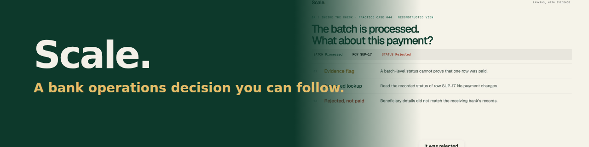
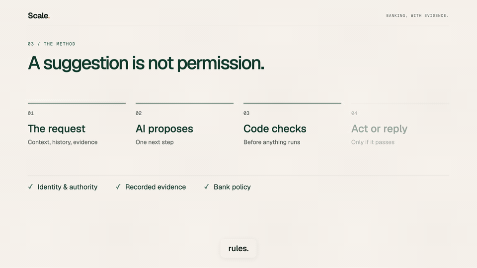
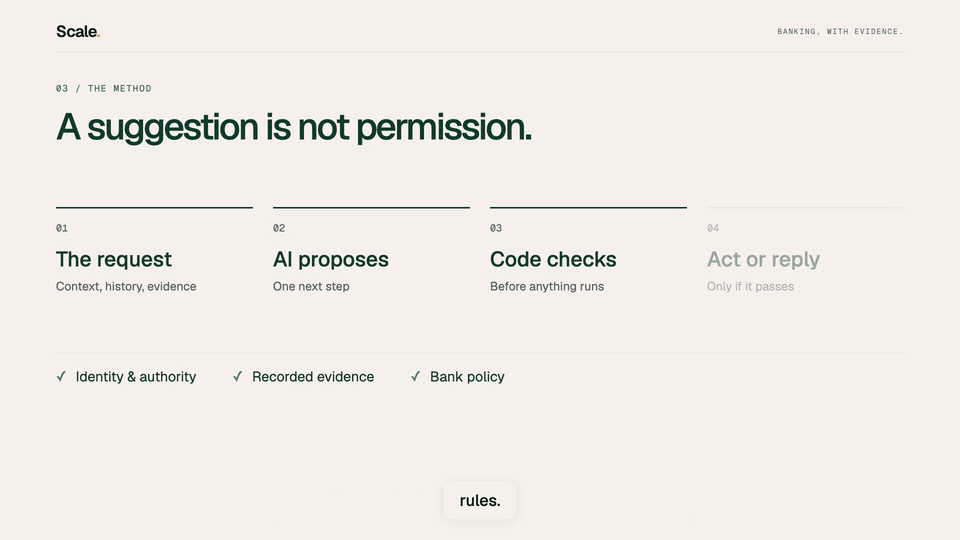
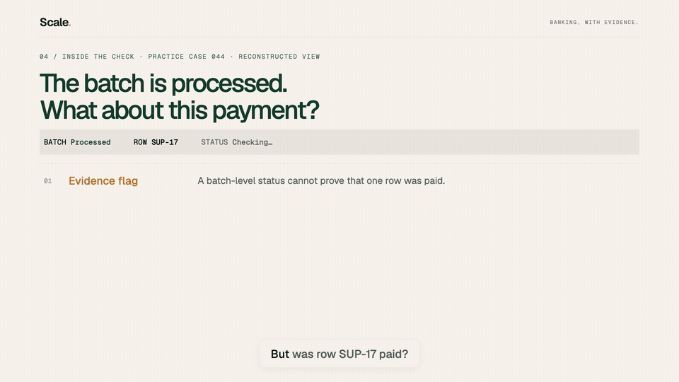
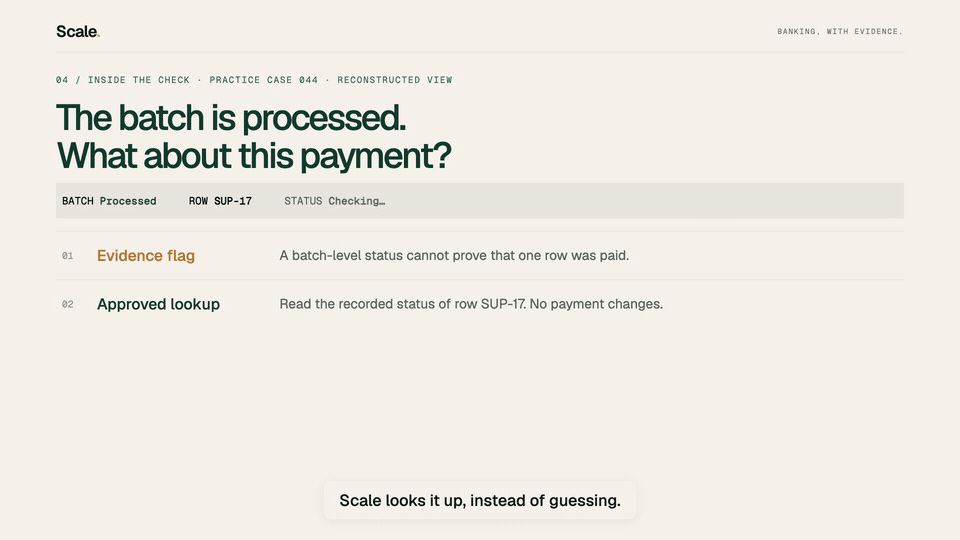
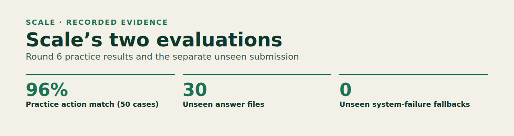
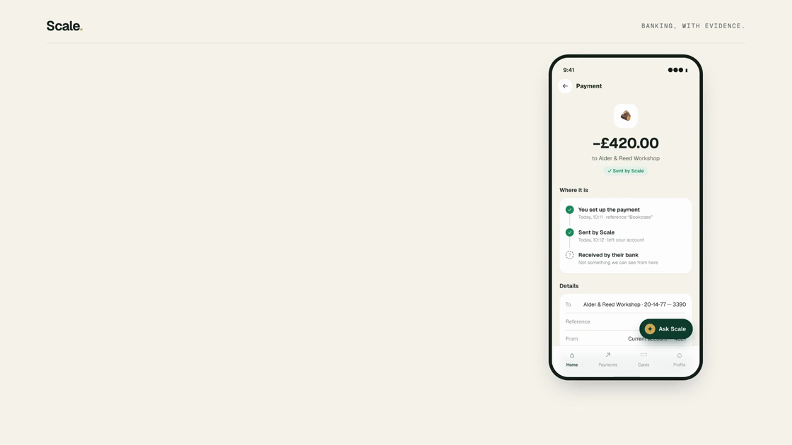
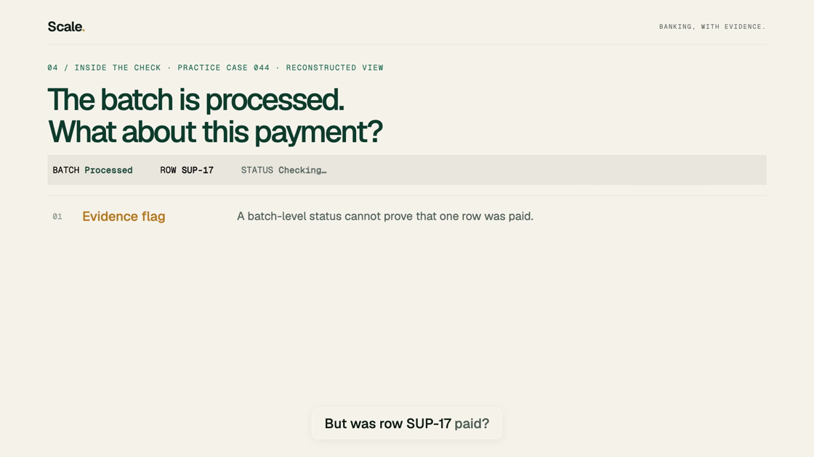
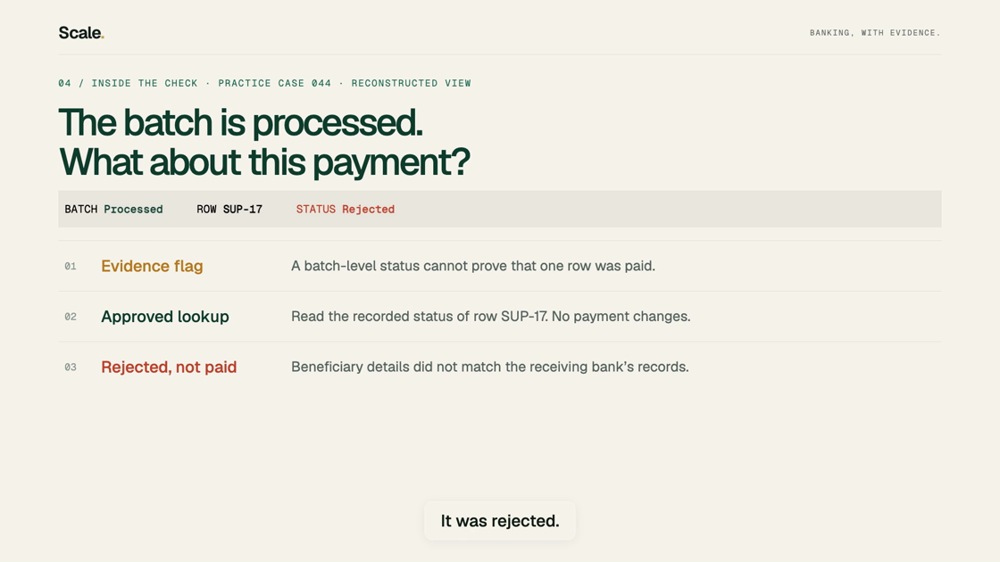

# Scale

[](LICENSE)
[](pyproject.toml)
[](#installation)

Bank support teams have to reconstruct what happened across the conversation, payment records and attachments before deciding what to tell a customer. A processed batch can still contain a rejected payment. Scale checks the specific record before drafting a reply or requesting an action.

The Round 6 practice evaluation recorded **96% action match on 50 cases** cut at the decision point. The separate unseen Reality Test submission includes 30 unedited answers produced by the frozen agent. [Practice evaluation](AGENT_SPEC.md) · [Reality Test submission](SUBMISSION.md)

Built for the Banking & Financial Services track at Dwelly's Real-World Agents Hackathon in London on 10 October 2026. Scale uses synthetic case files and mock bank services. The unseen-case runner looks up evidence and requests authorized changes for people to carry out.

**[Run a sample case](#installation)** · **[Watch the 58-second demo film](video.mp4)**



<sub>Excerpt from the product film showing the SUP-17 practice case. The case is synthetic. The film's benchmark card is from an earlier run.</sub>

## How it works

1. **Read the request and attachments together.** The case loader brings in the conversation and PDF, CSV or text evidence. The model receives the case at the point where a decision is needed (`agent/ingest/loader.py`, `agent/ingest/attachments.py`).

   

2. **Check the proposed action.** Code checks the evidence and the requester's authority before allowing a tool call. A row lookup distinguishes a processed batch from the state of the individual payment (`agent/checks/verify.py`, `agent/tools/executor.py`).

   

3. **Answer with evidence.** The run writes an answer, reasoning and trace with the supported outcome. For row SUP-17, the reply explains that it was rejected and keeps the different payment states explicit (`agent/core/loop.py`, `agent/core/writer.py`).

   

## Results



The practice evaluation used `claude-opus-5-5` on 50 cases, cut at the decision point. The unseen submission reports 30 answers and zero fallbacks. Its outputs are available for inspection in [ANSWERS/](ANSWERS/). [Practice scores](AGENT_SPEC.md) · [Unseen submission](SUBMISSION.md)

| Evidence set | Result |
| --- | --- |
| Practice cases | **MEASURED** · 96% action match, 9/10 judgement challenges passed |
| Unseen Reality Test | **MEASURED** · 30 answers, 0 system-failure fallbacks |

| Identify the request | Check the record | Explain the outcome |
| --- | --- | --- |
|  |  |  |

## Installation

You need Git, Python 3.11 or later, [uv](https://docs.astral.sh/uv/) and an Anthropic API key for the case runner.

```sh
git clone https://github.com/atiladeokegab/real-world-agents.git
cd real-world-agents
uv sync                      # Install the pinned dependencies
cp .env.example .env         # Set ANTHROPIC_API_KEY or both stage-specific keys
uv run agent run --case examples/044 --cut 2 --out /tmp/demo/044  # Run the supplier case
```

## Documentation

[Engineering design and evaluation](AGENT_SPEC.md) · [Inputs and example cases](examples/) · [Unseen outputs](ANSWERS/) · [Submission](SUBMISSION.md) · [Event rules](docs/rules/RULES.md).

## Contact

Open an [issue](https://github.com/atiladeokegab/real-world-agents/issues) with the case ID and outcome. Scale was built by [Atilade Oke](https://github.com/atiladeokegab) ([LinkedIn](https://www.linkedin.com/in/atiladeoke/)), [Abdussalam Popoola](https://github.com/Abdussalam-popsy), [Faisal Lawan](https://github.com/FHL-08) ([LinkedIn](https://www.linkedin.com/in/faisal-lawan/)) and [Jack Marshall](https://github.com/Drastixs).

## Contributing

See [TEAMWORK.md](TEAMWORK.md). Use synthetic examples and write any new run output to a separate directory so the archived test answers remain reproducible.

## Citation

```bibtex
@software{scale_2026,
  title = {Scale: Bank Operations Agent},
  author = {Oke, Atilade and Popoola, Abdussalam and Lawan, Faisal and Marshall, Jack},
  year = {2026},
  url = {https://github.com/atiladeokegab/real-world-agents}
}
```

## License

The code is [Apache-2.0](LICENSE). Practice and Reality Test examples use synthetic event material. See the [organizer's rules](docs/rules/RULES.md) for the source and terms of the event data.
