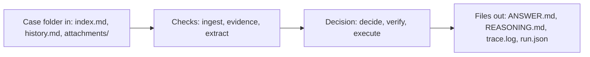

# Design

Designer: Abdussalam (@Abdussalam-popsy). Owned by the designer: to change anything here, open a
change-request (AGENTS.md §7) addressed to them. Each vertical's `Design:` line says which
sections of this page it must follow.

The mockup is `docs/mockup/index.html`: every screen and state, clickable, with the exact copy.
Open it in a browser: the case list shows every case with its one outcome; click a row for the case
page; `Esc` goes back. It is built for a bank operations reviewer, with a dark theme (midnight indigo, `#0F0E1D`) and a light theme (soft lavender-grey, `#EFEEF5`, never pure white), switched in the top bar. Type is Geist throughout, with
Geist Mono only for the run log, case numbers and file names. Colour appears only in the status
tags, step icons and tinted log lines (yellow for a warning, red for a rejection, magenta for a
failure). Escalations appear as a pinned note at the top of the case timeline, with "Take case"
and "Reply to customer".

References:
- [GitHub Actions](https://docs.github.com/en/actions):
  a list of runs with a status dot each; inside a run, the steps in order with the log collapsed
  until you ask for it. Our case list and the "What the agent did" card follow this.
- [Stripe Dashboard](https://stripe.com/payments): one object per page, a status pill
  next to the title, a plain timeline, details in a narrow side column. Our case page follows this.
- [Mercury](https://mercury.com): transactions as a borderless table with thin row lines, a small
  status tag next to the name and summary numbers above. Our case list follows this.
- [Vercel](https://vercel.com): deployment steps as collapsible rows with a status icon each, and
  warning or error lines tinted in the log. Our "What the agent did" follows this.
- [Zendesk agent workspace](https://www.zendesk.com): what the
  customer sees kept apart from internal notes. Our "Reply to the customer" and "Needs a person"
  cards follow this.
- [Stripe CLI](https://docs.stripe.com/stripe-cli): one line per step, aligned labels, colour only
  for outcomes. Our terminal output follows this.

## Flow

The operator runs one command. The terminal shows each stage on one line as it happens, then a
single outcome line. Everything the terminal shows is also in the files.

## Screens and commands

| Screen or command | Shows | The user can |
|---|---|---|
| `uv run agent run --case NNN [--question "…"]` | One line per stage (ingest, identity, evidence, extract, decide, verify, execute, write), then the outcome line with the state badge, actions, escalations and time | Read what happened; open the files the last line names |
| `uv run agent eval --cases FOLDER` | A progress line per case (`044 ✓ DONE  match`), then the summary block: action match, clean-case escalation rate, injected-case detection rate, cases per state | See whether a change helped or hurt; open any failed case's folder |
| Case list (mockup; a later viewer reads `ANSWERS/`) | One row per case: number, request, requester, channel, outcome pill, exception, time; filters by outcome with counts; a footer with blank answers and hand-offs | Filter by outcome; open a case |
| Case page → How it thought | Every step of the run in order, each labelled AI (Claude) or CODE (fixed rules): what was read, what the evidence checks flagged, what the AI understood (claims marked fact or claim with their event IDs, asks, unknowns, mood), each proposal with its reasons, each safety-check verdict, each tool result. Read from `trace.log`: `finding`, the extraction and decision `model_call` outputs (`claims`, `asks`, `unknowns`, `emotional_state`, `uncertainties`), `proposal`, `verdict`, `tool_result`. | Read the reasoning; press Replay to reveal the steps one at a time |
| Case page | Title and outcome pill, the decision in one sentence; "Needs a person" first when escalated; the reply to the customer; "What the agent did" as eight steps with the run log collapsed; "Not done, and why"; ANSWER.md and REASONING.md as tabs; a side column with requester, channel, identity, exception, output folder, evidence and what failed | Read the outcome; expand the run log; switch files; go back |
| `ANSWER.md` | The decision and everything done or not done, in the fixed headings of §Copy | Read the outcome in under 30 seconds |
| `REASONING.md` | The facts, findings, checks and alternatives behind the decision, in the fixed headings of §Copy | Audit why; follow event IDs back to the case |
| Handover note (a section of `ANSWER.md`, only when escalated) | Who should take it, how urgent, what is verified or only claimed, what was and wasn't done, the one question for the human, a safe holding reply | Pick the case up without re-reading it |

## States

Every case ends in exactly one of these six. The badge text and colour are fixed.

| State | Badge | Colour | When | Terminal outcome line |
|---|---|---|---|---|
| done | `DONE` | green `#1F9D6B` | A check or safe change happened and the result is real | `● DONE  1 action · 0 escalations` |
| requested, pending result | `REQUESTED` | amber `#D99A1E` | The agent asked the owning service for a check or change; no result yet (§4.3) | `◐ REQUESTED  pending result from payment journal` |
| request_info | `NEEDS INFO` | blue `#3A6FF7` | Something the agent can't safely guess: which item, or proof of identity | `? NEEDS INFO  1 question to the customer` |
| escalated | `ESCALATED` | vermilion `#E5533D` | A conflict, missing authority, risk or distress the agent must not resolve alone | `▲ ESCALATED  handover to Business Payments, urgent` |
| no_op | `NO ACTION` | slate `#8A8F98` | Nothing needs doing, and doing something would be wrong | `○ NO ACTION  nothing to do` |
| system failure | `SYSTEM FAILURE` | magenta `#B03A8C` | A crash, timeout or API failure; the fallback still writes a valid answer (§4.11) | `■ SYSTEM FAILURE  escalated with what we received` |

| Where | Empty | Loading | Error |
|---|---|---|---|
| `agent run` | No events found → the Claude fallback parse runs, and the terminal says `ingest  format not recognised, using fallback parse` | Each stage line appears when that stage finishes; the current stage shows `…` | Any stage error → the line turns magenta, the run continues to the system-failure fallback, exit code `0` |
| `agent eval` | `No cases found in FOLDER` and exit code `2` | One line per finished case | A case's failure counts in the summary; the run never stops |
| `ANSWER.md` | Never empty: the fallback writes every heading, with `None` where nothing applies | — | System-failure state: the headings stay, `What failed` names the stage and error |

## Copy

### Terminal stage labels

Lower case, padded to 10 characters, in this order: `ingest`, `identity`, `evidence`, `extract`,
`decide`, `verify`, `execute`, `write`. The verifier prints `✓` on approval and `✗ RULE` on
rejection (`✗ claim-linter: "paid" not in any tool result`).

### ANSWER.md headings, in order

| Heading | Words |
|---|---|
| Title | "# Answer — Case <N>" |
| 1 | "## Decision" — the badge word, then one sentence |
| 2 | "## What we received" — files, event count, cut point, identity level |
| 3 | "## Actions" — each with its outcome: `done`, `requested — pending result`, `not done` or `uncertain` |
| 4 | "## Answer to the question" — only when `--question` was supplied |
| 5 | "## Customer reply" — channel, then the exact message |
| 6 | "## Not done" — each with "because …" |
| 7 | "## Evidence used" — event IDs and tool results |
| 8 | "## Handover" — only when escalated |
| 9 | "## What failed" — "Nothing." when nothing did |

### REASONING.md headings, in order

| Heading | Words |
|---|---|
| Title | "# Reasoning — Case <N>" |
| 1 | "## Facts and claims" — each with its event ID; claims marked as claims |
| 2 | "## Findings" — each evidence-checker finding and how it was addressed |
| 3 | "## Policy checks" — identity, authority, risk level, completion, disclosure |
| 4 | "## Exception and handling" — the §4.8 type and its fixed handling, or "None" |
| 5 | "## Alternatives rejected" — each with why |
| 6 | "## Uncertainties" |

### Handover note fields, in order

"**Take it:**" team or role · "**Urgency:**" urgent / today / routine · "**Type:**" technical / emotional ·
"**Verified:**" · "**Only claimed:**" · "**Conflicts:**" · "**We did:**" · "**We did not:**" ·
"**Question for you:**" one question · "**Safe to send now:**" a holding reply that claims nothing.

### Customer-reply voice

Short and plain. Three parts, in this order: what we did, what happens next, when. No apology
padding, no promises a tool hasn't confirmed, no internal names. Example: "We've checked row
SUP-17 in your supplier batch. It was rejected because the beneficiary details didn't match the
receiving bank's records. The other rows haven't been rechecked."

### Reply templates

`{…}` is filled in by code; everything else is fixed.

| When | Words |
|---|---|
| Holding reply on escalation ("Safe to send now") | "Thank you for your message. We've passed your request to {team}, who will review it and reply to you here. We haven't made any changes to your account while this is reviewed." |
| request_info | "To make sure we act on the right request, please confirm: {question}" |
| Requested, pending result | "We've asked {team} to {check}. We'll reply here once they've confirmed." |
| System failure | "We've received your request and passed it to {team}. We'll reply here." |

### Words we never use unless a tool confirmed it

"paid", "received", "credited", "refunded", "resolved", "downloaded". Instead: "shown as sent",
"no credit found", "requested", "available in your portal".
